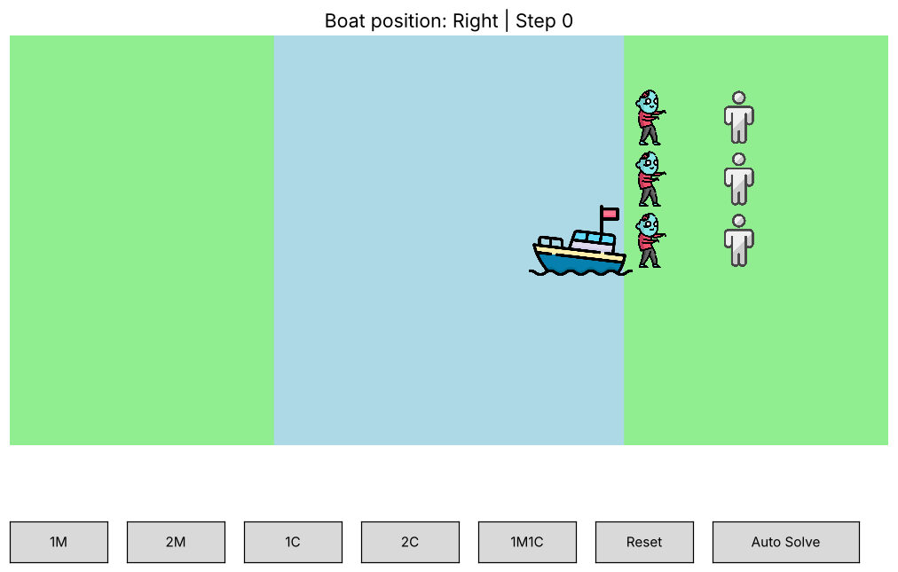

# Missionaries & Cannibals: River-Crossing Puzzle with a BFS Solver


-6f42c1)


> A playable version of the classic river-crossing puzzle. An **Auto Solve** button uses **Breadth-First Search** to find the shortest solution and animates it.



## 🎯 The puzzle

Three missionaries 🧍 and three cannibals 🧟 start on the right bank. Get everyone to the left bank with a boat that carries **1 or 2** people.

**Rule:** on either bank, the cannibals must never outnumber the missionaries (unless no missionaries are there).

## ✨ Features

- **Interactive GUI** built entirely from Matplotlib widgets, with sprite images and an animated boat.
- **Five move buttons** (`1M`, `2M`, `1C`, `2C`, `1M1C`) for playing by hand.
- **Win and loss detection** after every move.
- **Auto Solve:** BFS finds the optimal **11-move** solution and plays it out step by step.
- **Reset** returns to the starting position at any time.
- **Clean architecture:** `game_logic.py` holds the rules and the solver as pure, typed, UI-free code (an immutable `@dataclass` state), separate from the GUI.
- **Notebook walkthrough** that explains each part of the code. `translate.py` makes a Chinese-language copy of the notebook.

## 🧠 How the AI solves it

| Component | Implementation |
|---|---|
| **State** | `(M_left, C_left, M_right, C_right, boat_side)`, a frozen dataclass, so states can be hashed into a `visited` set |
| **Actions** | Move `(1,0)`, `(2,0)`, `(0,1)`, `(0,2)` or `(1,1)` across the river |
| **Validity check** | No negative counts, and missionaries are never outnumbered |
| **Goal test** | All six people on the left bank |
| **Search** | Breadth-First Search with a queue (`deque`) and a visited set |

BFS explores level by level, so the **first solution it finds is guaranteed to be the shortest**: 11 crossings.

```text
 #   Boat carries   Boat ends on        #   Boat carries   Boat ends on
 1.  2C             left bank           7.  2M             left bank
 2.  1C             right bank          8.  1C             right bank
 3.  2C             left bank           9.  2C             left bank
 4.  1C             right bank         10.  1M             right bank
 5.  2M             left bank          11.  1M + 1C        left bank   ✅ solved
 6.  1M + 1C        right bank
```

## 🚀 Getting started

```bash
git clone https://github.com/kfahchai-netizen/COS30019-INTRO-TO-AI-MISSIONARY_AND_CANNIBAL.git
cd COS30019-INTRO-TO-AI-MISSIONARY_AND_CANNIBAL/Missionary_and_Cannibal
pip install matplotlib
python standalone_game.py
```

> Run the script from inside `Missionary_and_Cannibal/`, because the sprite images are loaded by relative path.

To use the solver on its own:

```python
from game_logic import bfs_solve
print(bfs_solve())   # [(0, 2, 'left'), (0, 1, 'right'), ...]
```

## 📁 Project structure

```
Missionary_and_Cannibal/
├── standalone_game.py             # ▶ Matplotlib GUI: play manually or Auto Solve
├── game_logic.py                  # Rules, state model and BFS solver (no UI code)
├── missionary and cannibal.ipynb  # Notebook walkthrough with explanations
├── translate.py                   # Makes a Chinese-language copy of the notebook
└── boat.png, human.png, zombie.png
```

## 📚 Key concepts

State-space search · Breadth-First Search · Goal and validity tests · Separating logic from UI · Event-driven GUI programming

---

<sub>Made by **Kean Fah Chai** · Swinburne University of Technology Sarawak</sub>
